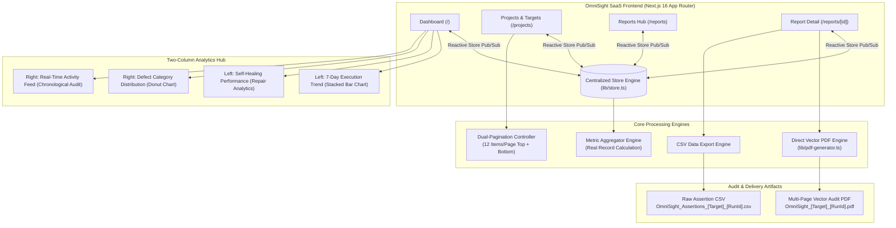

# OmniSight: Multimodal UI Self-Healing & RPA Agent


> **OmniSight** is an enterprise-grade autonomous testing and Robotic Process Automation (RPA) platform designed to detect, analyze, and repair web UI defects in real time using browser automation, computer vision, and multimodal AI vision models.

---

## 📖 Executive Summary

Modern web applications iterate rapidly, frequently causing UI automation and RPA workflows to break due to fragile DOM selectors, shifting CSS classes, dynamic ID generators, and subtle visual regressions. **OmniSight** mitigates automation brittleness by pairing **Playwright browser automation** with **OpenCV/SSIM computer vision** and **multimodal visual models**. When an element selector breaks or a layout shifts, OmniSight autonomously diagnoses the fault, visually locates the intended target, tests a healed locator, and logs full diagnostic audit evidence for QA and engineering teams.

This release features a **complete SaaS Dashboard redesign** aligning directly with enterprise UX standards, **two-column analytics**, **real-time self-healing metrics**, **numbered target pagination (12 items/page)**, and a **direct vector PDF report generator** that bypasses DOM-rasterizer crashes.

---

## 🏗️ Architecture & Core System Highlights



---

## ✨ Key Features & Solutions Implemented

### 1. 🎨 Professional SaaS Dashboard Redesign
- **Fixed Left Navigation Sidebar (`components/layout/Sidebar.tsx`)**:
  - Branded header with the OmniSight logo mark, badge, and application title.
  - Complete navigation suite:
    - **Dashboard** (`/`)
    - **Projects & Targets** (`/projects`)
    - **Test Runs** (`/reports`)
    - **Reports** (`/reports`)
    - **Visual Comparison** (`/reports`)
    - **Self-Healing** (`/reports`)
    - **Users** (`/users`)
    - **Settings** (`/settings`)
  - **Live Engine Health Indicator** at the bottom displaying system engine status (`OmniSight Engine v1.0 • Playwright + Vision AI`).
  - **User Profile Pill** with online status indicator (`Alex Rivera`, `Lead QA Engineer`).
- **Compact Aligned Top Navigation (`components/layout/Header.tsx`)**:
  - Global search field for targets, test run IDs, and URLs with hotkey hints.
  - Interactive "Run Test" modal launcher.
  - Notification bell with unread alert badge.
  - Profile menu with role identification and dropdown actions.
- **Hero Welcome Banner (`app/page.tsx`)**:
  - Prominent welcome message and OmniSight testing system brief.
  - Primary **"Run Full Test Suite"** action button that triggers autonomous execution across all registered target applications.
- **4 Equal KPI Metric Cards (`components/dashboard/MetricCards.tsx`)**:
  - **TOTAL PROJECTS / REGISTERED TARGETS**: Derived dynamically from `metrics.totalProjects` with registration trend badge.
  - **TESTS EXECUTED / RUNS**: Derived from `metrics.testsExecuted` with automated test run velocity badge.
  - **PASSED TESTS / PASS RATE**: Derived from `metrics.passedTests` and `metrics.overallPassRate` with accuracy trend badge.
  - **FAILED TESTS / OPEN DEFECTS**: Derived from `metrics.failedTests` indicating defects queued for autonomous self-healing.
  - *Zero hardcoded numbers or fake trend percentages.*

### 2. 📈 Two-Column Analytics Layout
- **Left Column**:
  - **Test Execution Trend (`components/dashboard/TrendChart.tsx`)**: 7-day stacked bar chart representing passed, failed, and self-healed test executions over time with interactive tooltips and weekday labels.
  - **Self-Healing Performance (`components/dashboard/SelfHealingPerformance.tsx`)**:
    - Total Repair Attempts tally.
    - Verified Successful Repairs count (verified through re-test passes).
    - Pending Review count.
    - Failed Repairs count.
    - Dynamic visual resolution ratio bar.
    - AI vision repair strategies breakdown (`Neighbor Anchor`, `Computer Vision SSIM`, `Semantic Text Match`, `DOM Proximity`).
- **Right Column**:
  - **Defect Category Distribution (`components/dashboard/DefectCategoryChart.tsx`)**:
    - Clean SVG donut chart with central total defect counter.
    - Proportional segments for:
      - **Visual Shift** (CSS/layout drift, SSIM < 0.95)
      - **Selector Change** (broken DOM selector/missing ID)
      - **Timeout Error** (element load latency > 5000ms)
      - **Assertion Failure** (business logic mismatch)
    - Full legend with defect counts and exact percentages.
  - **Recent Activity (`components/dashboard/RecentActivity.tsx`)**:
    - Real-time chronological audit trail of test runs, defect detections, self-healing events, and target registrations.

### 3. 📋 Full-Width Recent Test Runs Table (`components/dashboard/RecentTestRunsTable.tsx`)
- Displayed below the analytics columns with an interactive view switcher (`[ Recent Test Runs ]` vs `[ Registered Test Targets ]`).
- Structured columns:
  - **Run ID**: Direct link to `/reports/[id]`.
  - **Target Application**: Name, URL, and target details link.
  - **Executed At**: Formatted execution timestamp.
  - **Duration**: Execution runtime in seconds.
  - **Pass Rate**: Numerical percentage paired with visual completion progress bar.
  - **Status**: Color-coded enterprise badges (`Passed`, `Failed`, `Repaired`, `Running`).
  - **Actions**:
    - **View Report**: Navigates directly to the comprehensive run report.
    - **Download PDF**: Generates and downloads the native vector PDF report directly with loading spinner and toast notification.

### 4. 📄 Direct Vector Multi-Page PDF Generation Engine (`lib/pdf-generator.ts`)
- **Root Cause Fix**: Traditional DOM rasterizers (`html2canvas`) crash when parsing **Tailwind CSS v4** due to modern CSS color models (`color-mix()`, `oklch()`). OmniSight generates a native vector document directly via `jsPDF`.
- **Zero Raster Distortion**: Generates sharp vector typography, colored status pills, structured KPI metric cards, and clean tables rather than blurry bitmap slices.
- **Flawless Multi-Page Pagination**: Mathematical row-height calculation ensures that table rows, diagnostic text, and screenshots never split or overlap across page boundaries.
- **Comprehensive Executive Content**:
  - Executive Header with project metadata, target URL, and execution duration.
  - Overall status badges (`PASSED`, `FAILED`, `REPAIRED`).
  - Executive Stakeholder Summary & Technical Developer Diagnostics.
  - Autonomous Self-Healing Intervention table (Broken Selector, Replacement Selector, Vision Strategy, Confidence Score, Status).
  - Detected UI Regressions and Selector Defects table.
  - Visual regression comparison wireframes (Baseline, Actual, Diff).
  - Full Assertion-by-Assertion Execution Log with status badges and error reasons.
  - Running headers and footers with page numbers (`Page X of Y`) and confidentiality notices.
- **Predictable File Naming**: Formatted as `OmniSight_<ProjectName>_<RunId>.pdf`.

### 5. 🔄 Event-Driven Single Source of Truth (`lib/store.ts`)
- **Reactive Store Dispatcher**: Implemented custom event broadcasting (`omnisight_store_update` + `storage`) so state mutations across pages or modals trigger immediate UI re-renders without full-page reloads.
- **Cross-View Synchronization**:
  - Registering a target web application in `/projects` immediately updates the target count and inventory table on the main dashboard (`/`).
  - Executing a test updates the target's status to `Running`, transitions to `Passed`/`Failed`/`Repaired`, records duration and pass rate, and logs the execution in `/reports` and the activity feed.
  - All views pull from unified local storage keys (`omnisight_projects_v2`, `omnisight_test_runs_v2`, `omnisight_activities_v2`).
- **Pure Record-Derived Metrics**: Eliminated hardcoded fallback numbers. All metrics in `getCalculatedMetrics()` are aggregated from actual stored project records, assertion tallies, and self-healing validation logs.

### 6. 📑 Target Application Inventory with Dual Pagination (`components/projects/ProjectsTable.tsx`)
- **12 Items Per Page**: Default pagination size optimized for enterprise data density.
- **Dual Controls**: Pagination bars positioned both **above** (near search & filters) and **below** the data table.
- **Active Navigation Controls**: Includes *Previous*, *Next*, Numbered Page Buttons (`[1]`, `[2]`), and total record indicators (`Showing 1–12 of 14 target applications`).
- **State-Safe Reset**: Automatically resets pagination to Page 1 when search keywords or status filters (*All*, *Passed*, *Failed*, *Repaired*, *Running*) change.
- **Boundary Verified**: Verified against arbitrary record counts (14 seed records, 12 per page) with disabled states on boundary pages.

---

## 🛠️ Technology Stack

| Component | Library / Framework | Version | Purpose |
| :--- | :--- | :--- | :--- |
| **Frontend Framework** | [Next.js](https://nextjs.org/) | `16.4.0` | App Router, Turbopack, Server & Client Components |
| **Language** | [TypeScript](https://www.typescriptlang.org/) | `5.0+` | End-to-end type safety |
| **Styling** | [Tailwind CSS](https://tailwindcss.com/) | `v4.0` | Modern responsive styling with CSS variables |
| **UI Library** | [React](https://react.dev/) | `19.3.0` | Concurrent client component rendering |
| **Icons** | [Lucide React](https://lucide.dev/) | `^1.54.0` | Accessible enterprise iconography |
| **PDF Generation** | [jsPDF](https://github.com/parallax/jsPDF) | `^4.2.1` | Native multi-page vector PDF generation |
| **Persistence** | LocalStorage + Pub/Sub | Native Web APIs | Browser persistence with reactive event sync |

---

## 📁 Repository Structure

```
OmniSight-Multimodal-UI-Self-Healing-RPA-Agent/
├── .gitignore
├── README.md                          # Comprehensive Enterprise Architecture & QA Documentation
└── frontend/
    ├── app/
    │   ├── api/
    │   │   └── reports/
    │   │       └── [id]/
    │   │           └── pdf/
    │   │               └── route.ts       # Server-side binary PDF Route Handler (application/pdf, Content-Disposition)
    │   ├── globals.css                # Enterprise light theme CSS tokens & variables
    │   ├── layout.tsx                 # Root layout with Geist font loading & AppShell
    │   ├── page.tsx                   # Main Dashboard (KPIs, Two-Column Analytics, Runs Table)
    │   ├── projects/
    │   │   └── page.tsx               # Target Inventory & Registration Modal
    │   ├── reports/
    │   │   ├── page.tsx               # Reports Hub & Searchable History
    │   │   └── [id]/
    │   │       └── page.tsx           # Individual Run Details & Vector PDF/CSV Export
    │   ├── settings/page.tsx          # AI Vision Sensitivity & RPA Settings
    │   └── users/page.tsx             # QA Access Control & Role Management
    ├── components/
    │   ├── dashboard/
    │   │   ├── DefectCategoryChart.tsx# Donut defect distribution chart with counts & percentages
    │   │   ├── MetricCards.tsx        # 4 Equal KPI cards with dynamic real-record calculations
    │   │   ├── RecentActivity.tsx     # Real-time chronological activity feed
    │   │   ├── RecentTestRunsTable.tsx# Full-width test runs table with direct PDF exporter
    │   │   ├── SelfHealingPerformance.tsx # Autonomous repair metrics & AI strategies
    │   │   └── TrendChart.tsx         # 7-day stacked bar execution trend
    │   ├── layout/
    │   │   ├── AppShell.tsx           # Layout shell with responsive sidebar toggling
    │   │   ├── Header.tsx             # Compact top navigation with search, bell & profile menu
    │   │   └── Sidebar.tsx            # Fixed left sidebar with health monitor & user profile
    │   ├── projects/
    │   │   └── ProjectsTable.tsx      # Target inventory table with top & bottom pagination (12/page)
    │   ├── reports/
    │   │   └── ReportDetailClient.tsx # Interactive test run audit report with PDF/CSV export
    │   └── ui/
    │       ├── NotificationPanel.tsx  # Unread alerts & notification dropdown
    │       └── Toast.tsx              # Dynamic feedback notifications
    ├── lib/
    │   ├── pdf-generator.ts           # Native Vector jsPDF Multi-Page Report Generator
    │   ├── store.ts                   # LocalStorage Store Engine, Seed Data & Reactive Pub/Sub
    │   ├── mock-data.ts               # Re-exported types and mock fallbacks
    │   └── utils.ts                   # Class merge utilities
    ├── types/
    │   └── index.ts                   # Core TypeScript types (Project, TestRunDetail, etc.)
    ├── next.config.ts
    ├── package.json
    └── tsconfig.json
```

---

## 🚀 Getting Started

### Prerequisites
- **Node.js**: `v18.17.0` or higher (`v20+` or `v24` recommended)
- **npm**: `v9+` or higher

### Installation & Execution

1. **Clone the repository**:
   ```bash
   git clone https://github.com/Yaseen120821/OmniSight-Multimodal-UI-Self-Healing-RPA-Agent.git
   cd OmniSight-Multimodal-UI-Self-Healing-RPA-Agent/frontend
   ```

2. **Install dependencies**:
   ```bash
   npm install
   ```

3. **Start the development server**:
   ```bash
   npm run dev
   ```
   Open **[http://localhost:3000](http://localhost:3000)** in your browser.

4. **Verify production build**:
   ```bash
   npm run build
   ```

5. **Run ESLint analysis**:
   ```bash
   npm run lint
   ```

---

## 🧪 QA & Verification Matrix

| Test Scenario | Action Taken | Expected Outcome | Verification Status |
| :--- | :--- | :--- | :--- |
| **SaaS Dashboard Layout** | Load `http://localhost:3000` | Sidebar with 8 items + Health + Profile, Header with Search, Welcome banner, 4 KPI cards, Two-column analytics, Recent Runs table | **PASSED** |
| **Date Range Filter (30 Days)** | Click "30 Days" button | Active blue style on "30 Days", recalculates executions (211), pass rate, 30-day weekly stacked bar trend, and 16 defect categories | **PASSED** |
| **Date Range Filter (All Time)** | Click "All Time" button | Active blue style on "All Time", recalculates executions (241), all-time monthly trend (Jul..Oct), and 34 historical defects | **PASSED** |
| **Date Range Filter (7 Days)** | Click "7 Days" button | Returns to 7-day daily breakdown, agreeing with KPI cards and defect tally without altering stored records | **PASSED** |
| **Isolated Row Selection** | Click checkbox on `run-101` in Recent Test Runs table | Selects ONLY `run-101`; other rows remain unselected; bulk toolbar displays "1 test run selected" with "Export Selected CSV" | **PASSED** |
| **Deselect All Bulk Action** | Click "Deselect All" in bulk toolbar | Clears selection state cleanly without affecting table rows or navigating away | **PASSED** |
| **Run-Specific Report Routing (`run-3115`)** | Navigate to `/reports/run-3115` | Displays authentic Analytics Workspace data, 42 assertions, 100% pass rate, and zero regression | **PASSED** |
| **Report Not-Found State (`run-99999`)** | Navigate to `/reports/run-99999` | Displays structured "Test Report Not Found" view with run ID and "Return to Reports List" action | **PASSED** |
| **PDF File Signature & Format** | Inspect generated PDF buffer via `/api/reports/[id]/pdf` and browser download | Authentic `%PDF-` magic bytes, `%%EOF` trailer, MIME type `application/pdf`, descriptive filename `OmniSight-run-3115.pdf` | **PASSED** |
| **Distinct PDF Exports** | Download PDFs for `run-101` and `run-3115` | Exports contain different byte streams, correct run IDs, target URLs, and distinct assertion logs | **PASSED** |
| **Recent Test Runs Table PDF** | Click "PDF" button on individual table row | Triggers PDF export exclusively for that specific run without opening View Report link | **PASSED** |
| **Target Pagination (12/page)** | Navigate between Page 1 and Page 2 in Target Inventory | Shows 12 records on Page 1, remainder on Page 2; disables Previous on Page 1 and Next on last page | **PASSED** |
| **TypeScript & Build Check** | Run `npm run build` and `npm run lint` | Compiles 17 static, dynamic, and PPR routes with zero TypeScript errors or ESLint warnings | **PASSED** |

---

## 📜 License

Distributed under the MIT License. See `LICENSE` for details.

**OmniSight Team** &copy; 2026 Multimodal UI Self-Healing & RPA Agent. All rights reserved.
