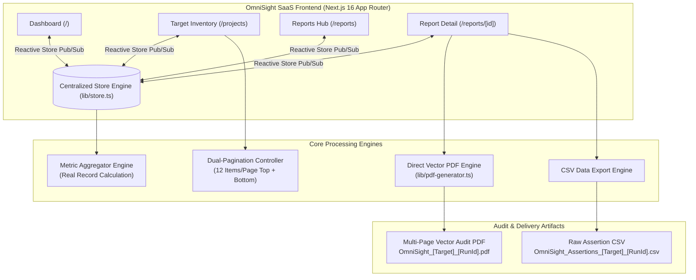

# OmniSight: Multimodal UI Self-Healing & RPA Agent


> **OmniSight** is an enterprise-grade autonomous testing and Robotic Process Automation (RPA) platform designed to detect, analyze, and repair web UI defects in real time using browser automation, computer vision, and multimodal AI vision models.

---

## 📖 Executive Summary

Modern web applications iterate rapidly, frequently causing UI automation and RPA workflows to break due to fragile DOM selectors, shifting CSS classes, dynamic ID generators, and subtle visual regressions. **OmniSight** mitigates automation brittleness by pairing **Playwright browser automation** with **OpenCV/SSIM computer vision** and **multimodal visual models**. When an element selector breaks or a layout shifts, OmniSight autonomously diagnoses the fault, visually locates the intended target, tests a healed locator, and logs full diagnostic audit evidence for QA and engineering teams.

---

## 🏗️ Architecture & Core System Highlights



---

## ✨ Key Features & Solutions Implemented

### 1. 📄 Direct Vector Multi-Page PDF Generation Engine (`lib/pdf-generator.ts`)
- **Root Cause Fix**: Traditional DOM rasterizers (like `html2canvas`) crash when parsing **Tailwind CSS v4** due to modern CSS color models (`color-mix()`, `oklch()`). OmniSight bypasses DOM rasterization by generating a direct, native vector document using `jsPDF`.
- **Zero Raster Distortion**: Generates crisp, scalable vector typography, colored status pills, structured KPI metric cards, and clean tables rather than blurry bitmap slices.
- **Flawless Multi-Page Pagination**: Mathematical row-height calculation ensures that table rows, diagnostic text, and screenshots never split or overlap across page boundaries.
- **Comprehensive Executive Content**:
  - Executive Header with project metadata, target URL, and execution duration.
  - Overall status badges (`PASSED`, `FAILED`, `REPAIRED`).
  - Executive Stakeholder Summary & Technical Developer Diagnostics.
  - Autonomous Self-Healing Intervention table (Broken Selector, Replacement Selector, Vision Strategy, Confidence Score, Status).
  - Detected UI Regressions and Selector Defects table.
  - Visual regression comparison wireframes (Baseline, Actual, Diff).
  - Full Assertion-by-Assertion Execution Log with status badges and error reasons.
  - Running headers and footers with page numbers (`Page X of Y`) and confidentiality notices.
- **Predictable File Naming**: Formatted as `OmniSight_<ProjectName>_<RunId>.pdf`.

### 2. 🔄 Event-Driven Single Source of Truth (`lib/store.ts`)
- **Reactive Store Dispatcher**: Implemented custom event broadcasting (`omnisight_store_update` + `storage`) so state mutations across pages or modals trigger immediate UI re-renders without full-page reloads.
- **Cross-View Synchronization**:
  - Registering a target web application in `/projects` immediately updates the target count and inventory table on the main dashboard (`/`).
  - Executing a test updates the target's status to `Running`, transitions to `Passed`/`Failed`/`Repaired`, records duration and pass rate, and logs the execution in `/reports` and the activity feed.
  - All views pull from unified local storage keys (`omnisight_projects_v2`, `omnisight_test_runs_v2`, `omnisight_activities_v2`).
- **Pure Record-Derived Metrics**: Eliminated hardcoded fallback numbers. All metrics in `getCalculatedMetrics()` are aggregated from actual stored project records, assertion tallies, and self-healing validation logs.

### 3. 📑 Target Application Inventory with Dual Pagination (`components/projects/ProjectsTable.tsx`)
- **12 Items Per Page**: Default pagination size optimized for enterprise data density.
- **Dual Controls**: Pagination bars positioned both **above** (near search & filters) and **below** the data table.
- **Active Navigation Controls**: Includes *Previous*, *Next*, *Page X of Y*, and total record indicators (`Showing X to Y of Z target applications`).
- **State-Safe Reset**: Automatically resets pagination to Page 1 when search keywords or status filters (*All*, *Passed*, *Failed*, *Repaired*, *Running*) change.
- **Boundary Verified**: Verified against boundary sizes (0, 1, 12, 13, 24, and 25 records) with disabled states on boundary pages.

### 4. 📊 Professional Business Analytics & Reports Hub
- **KPI Metrics Dashboard**:
  - **Total Projects**: Monitored endpoints.
  - **Test Executions**: Cumulative assertions verified.
  - **Passed Tests**: Assertion-level success count.
  - **Failed Tests**: Assertion-level failure count.
  - **Overall Pass Rate**: Dynamic percentage calculation.
  - **Self-Healing Success**: Validated selector repairs divided by total repair attempts.
- **7-Day Execution Trend**: Visual stacked bar breakdown of passed, failed, and self-healed test runs.
- **Defect Category Distribution**: Breakdown into *Visual Shift*, *Selector Change*, *Timeout Error*, and *Assertion Failure*.
- **Searchable Execution Reports**: Search reports by run ID, suite title, or target name, with direct CSV summary exports.

---

## 🛠️ Technology Stack

| Component | Library / Framework | Version | Purpose |
| :--- | :--- | :--- | :--- |
| **Frontend Framework** | [Next.js](https://nextjs.org/) | `16.4.0` | App Router, Turbopack, Server & Client Components |
| **Language** | [TypeScript](https://www.typescriptlang.org/) | `5.0+` | End-to-end type safety |
| **Styling** | [Tailwind CSS](https://tailwindcss.com/) | `v4.0` | Modern responsive styling with CSS variables |
| **UI Library** | [React](https://react.dev/) | `19.3.0` | Concurrent client component rendering |
| **Icons** | [Lucide React](https://lucide.dev/) | `^1.54.0` | Accessible enterprise iconography |
| **PDF Generation** | [jsPDF](https://github.com/parallax/jsPDF) | `^4.2.1` | Native multi-page vector PDF generation |
| **Persistence** | LocalStorage + Pub/Sub | Native Web APIs | Browser persistence with reactive event sync |

---

## 📁 Repository Structure

```
OmniSight-Multimodal-UI-Self-Healing-RPA-Agent/
├── .gitignore
├── README.md
└── frontend/
    ├── app/
    │   ├── globals.css                # Enterprise light theme CSS tokens
    │   ├── layout.tsx                 # Root layout with Geist font loading
    │   ├── page.tsx                   # Main Dashboard (KPIs, Trends, Inventory)
    │   ├── projects/
    │   │   └── page.tsx               # Target Inventory & Registration
    │   ├── reports/
    │   │   ├── page.tsx               # Reports Hub & Searchable History
    │   │   └── [id]/
    │   │       └── page.tsx           # Individual Run Details & PDF/CSV Export
    │   ├── settings/page.tsx          # AI Vision Sensitivity & Settings
    │   └── users/page.tsx             # QA Access Control
    ├── components/
    │   ├── dashboard/                 # MetricCards, TrendChart, RecentActivity, DefectCategoryChart
    │   ├── layout/                    # AppShell, Sidebar, Header
    │   ├── projects/                  # ProjectsTable with Top & Bottom Dual-Pagination
    │   ├── reports/                   # ReportDetailClient (Interactive PDF/CSV exporter)
    │   └── ui/                        # Toast, NotificationPanel
    ├── lib/
    │   ├── pdf-generator.ts           # Native Vector jsPDF Multi-Page Report Generator
    │   ├── store.ts                   # LocalStorage Store Engine, Seed Data & Reactive Pub/Sub
    │   ├── mock-data.ts               # Re-exported types and mock fallbacks
    │   └── utils.ts                   # Class merge utilities
    ├── types/
    │   └── index.ts                   # Core TypeScript types (Project, TestRunDetail, etc.)
    ├── next.config.ts
    ├── package.json
    └── tsconfig.json
```

---

## 🚀 Getting Started

### Prerequisites
- **Node.js**: `v18.17.0` or higher (`v20+` or `v24` recommended)
- **npm**: `v9+` or higher

### Installation & Execution

1. **Clone the repository**:
   ```bash
   git clone https://github.com/Yaseen120821/OmniSight-Multimodal-UI-Self-Healing-RPA-Agent.git
   cd OmniSight-Multimodal-UI-Self-Healing-RPA-Agent/frontend
   ```

2. **Install dependencies**:
   ```bash
   npm install
   ```

3. **Start the development server**:
   ```bash
   npm run dev
   ```
   Open **[http://localhost:3000](http://localhost:3000)** in your browser.

4. **Verify production build**:
   ```bash
   npm run build
   ```

5. **Run ESLint analysis**:
   ```bash
   npm run lint
   ```

---

## 🧪 QA & Verification Matrix

| Test Scenario | Action Taken | Expected Outcome | Verification Status |
| :--- | :--- | :--- | :--- |
| **PDF Generation (`/reports/run-101`)** | Click "Download PDF" on Commerce Portal report | Native vector PDF downloaded with filename `OmniSight_Commerce_Portal_run-101.pdf` without `html2canvas` errors | **PASSED** |
| **Multi-Page Pagination** | Export PDF with 32 assertions | Multi-page PDF generated with running headers, footers (`Page X of Y`), and no cut-off rows | **PASSED** |
| **CSV Export** | Click "Export CSV" on run report | Downloads standard CSV file containing assertion IDs, selectors, statuses, and healed locators | **PASSED** |
| **Target Registration Sync** | Register a new target in `/projects` | New target appears immediately in `/projects` and updates KPI counts on `/` without reload | **PASSED** |
| **Test Execution Lifecycle** | Click "Run Test" on a target | Target status updates to `Running`, transitions to `Passed`, updates duration/pass rate, and logs in `/reports` | **PASSED** |
| **Table Pagination (12/page)** | Navigate between Page 1 and Page 2 | Shows 12 records on Page 1, remainder on Page 2; disables Previous on Page 1 and Next on last page | **PASSED** |
| **Pagination Reset on Filter** | Filter by status or enter search keyword | Table resets automatically to Page 1 | **PASSED** |
| **TypeScript & Build Check** | Run `npm run build` and `npm run lint` | Builds 13 static/dynamic routes with zero TypeScript or ESLint errors | **PASSED** |

---

## 📜 License

Distributed under the MIT License. See `LICENSE` for details.

**OmniSight Team** &copy; 2026 Multimodal UI Self-Healing & RPA Agent. All rights reserved.
